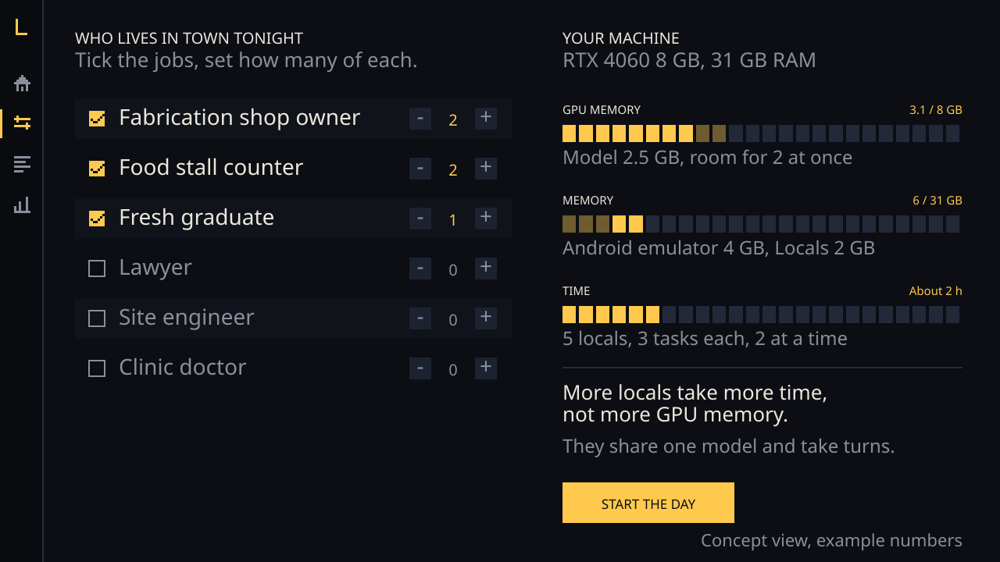

<p align="center">
  
</p>

<p align="center">
  <b>Locals</b> is a small town of AI users that lives on your own machine.<br>
  Each local has a job, a workday and a reason to open your app.<br>
  They use it the way real people would, get stuck where real people would,<br>
  and tell you where it happened and what they did instead.
</p>

<p align="center">
  <a href="#roadmap"></a>
  <a href="#why-it-runs-locally"></a>
  <a href="study/README.md"></a>
  <a href="LICENSE"></a>
</p>

> **Day 1.** Eighteen draft locals live in the town and can already use web apps in a real browser, thinking with a small model on this laptop. They are built from the [study](study/README.md) of the people they stand for, and stay marked draft until real people in those jobs confirm their profiles. [Run them](#run-it), or [help get a profile right](#leave-a-review).

<br>

## The town

<p align="center">
  
</p>

Three quarters of the screen is the town. Every pixel person is a real run: a local walking to work, opening your app, doing a task. When one gets stuck, a bubble appears over their head. The last quarter is the feed, where each local says what went wrong and what they did instead. Click a line and you watch the moment it happened.

The image above is a concept with example entries, drawn from a real app: in [Pops](https://github.com/BiswasMosam/Pops) the advance is entered on an order's detail screen, not on the new order form, which is exactly where a hurried user might look first. Whether that is a real problem is what a run is for.

## A real run

Rohit is a junior advocate standing in a court corridor with files under one arm and an old phone in the other hand. He reads the first six words of anything. His task: turn a large photo into a smaller JPG in [PixelShift](https://github.com/BiswasMosam/PixelShift). This is his actual run on the live site, with his longer thoughts shortened:

```
10 ROHIT  Junior advocate · phone · PixelShift: small-jpg
   1  tap [4] "IMAGE CONVERTER 10 IN"    Need to upload photo.png first.
   2  tap [7] "JPG Small"                Change to JPG / Small to reduce size
   3  tap [12] "QUALITY"                 Lower quality to make file smaller
   4  tap [12] "QUALITY"                 Lower quality to shrink file size, so it fits
   5  tap [12] "QUALITY"                 Lower the quality to shrink the file size
  STUCK      Kept landing on the same screen; nothing they tried changed it.
   6  set [12] "QUALITY" = 20            Lower quality to reduce file size
   7  set [12] "QUALITY" =               Lower quality to reduce file size. Try 10%.
   8  tap [13] "Convert and download"    Try converting after lowering quality.
  DONE       photo.jpg, 0.7 MB · 8 steps · 45s · after being stuck
```

He tapped the quality slider three times expecting it to go down before finding another way. Sunil, a food stall cook who glances at three words at a time, did the same task in four steps. Every step is saved with a screenshot for replay.

## What a local tells you

Locals reports **behaviour, not wishlists**. Ask an AI what features it wants and you get a confident list of generic ideas. Watch it try to do a job and you get something better:

| | Example |
|---|---|
| **Stuck** | "Customer paid the advance. The new order form has no box for it." |
| **Workaround** | "Wrote the advance in Notes instead." |
| **Done** | "Three orders in 1:52. Every total right." |

When a local cannot do something and does something else instead, that workaround is the feature request.

## Why it runs locally

- **Free per run.** A local can come back on simulated day 3 and day 20, the way real people do. That many steps would cost real money on a cloud API; here it costs electricity.
- **Your data stays home.** Apps with real customers and real orders never leave your machine.
- **Repeatable.** Fixed model weights and settings mean the same run gives the same result, so when a number changes you know it was your fix.

## Fits your machine

<p align="center">
  
</p>

Not everyone has a big GPU. Before a run you tick the jobs you want in town and set how many of each, and Locals shows what your machine will spend: GPU memory, memory and time.

All locals share one model and take turns, so **more locals cost more time, not more GPU memory**. Memory depends on which model you pick and how many locals act at the same moment. A smaller machine still runs the whole town; it just takes longer.

## How it works

| Part | What it does |
|---|---|
| **The town** | A workday hands each local tasks with real pressure: a call in the middle of a form, a dropped connection, a killed app. |
| **The locals** | One model, many people. A local is a profile from the study turned into a prompt plus a set of limits. |
| **Eyes** | Locals see what a person sees: visible controls by their visible words, a big card line by line, an icon with no words as just an icon. On the web this comes from a real Chrome on a phone sized or laptop sized screen; Android comes next. |
| **Limits** | Code, not the prompt, makes a local human: a patience budget, a reading budget, a slip rate, rules for giving up. Research shows a prompt alone leaves AI users far too patient and accurate. |
| **The golden path** | You do each task once while it is recorded. Wherever a local leaves your path, the UI misled it. |
| **Proof** | A task counts as done only when the app's real state says so, never on the local's word. |

## The study

AI users have a known problem: they are too good. Studies find them more cooperative, more accurate and more patient than real people, and a persona written as "you are a 50 year old shop owner" mostly makes their answers sound believable, not more true. People built from real interviews do far better.

So every local starts as a profile of a real job, built from interviews and published data, with every claim tagged by where it came from. [Read the method and the research behind it](study/README.md).

| Job | App it tests | Profile |
|---|---|---|
| Fabrication shop owner | Pops | [Draft](study/profiles/fabricator.md) |
| Food stall counter | Order Control | [Draft](study/profiles/food-stall.md) |
| Fresh graduate, photographer, collector, recruiter | Fill.ai, PixelShift, Peghunt, portfolio | Planned |
| [Law](study/profiles/law/README.md): trial court advocate, junior advocate, firm associate, in-house counsel | The wider town | Drafts |
| Engineering: software, mechanical, civil, electrical, electronics (eight types) | The wider town | Next |
| Finance, health, education | The wider town | Planned |

## Run it

You need Python 3.11 or newer, Google Chrome and [Ollama](https://ollama.com).

```bash
git clone https://github.com/BiswasMosam/Locals
cd Locals
python -m venv .venv
.venv/Scripts/pip install -r requirements.txt   # on macOS or Linux: .venv/bin/pip
ollama pull qwen3:4b-instruct

python -m town people                                    # everyone who lives in the town
python -m town run pixelshift:small-jpg rohit sunil      # send two locals to a task
python -m town run pixelshift:small-jpg all --watch      # everyone, with the browser visible
```

Each run lands in `runs/` with the feed, every step the local took, and a screenshot of each screen. Locals live in [people/](people), one file each; tasks live in [tasks/](tasks), one file per app. Set `LOCALS_MODEL` to try another model.

## Roadmap

- [x] Name, method and profile template
- [x] First two profiles drafted from a real business
- [x] Law family: four types of lawyer drafted
- [x] Eighteen draft locals that use web apps in a real browser
- [ ] Engineering family: eight types
- [ ] Interviews with a real fabricator and a real food stall
- [ ] Locals on Android: Pops on the emulator
- [ ] Limits set from watching real people do the same tasks
- [ ] Setup screen with the resource estimate
- [ ] The town view
- [ ] Profiles for the wider town

## Leave a review

Locals is built in the open and gets better when people who do these jobs tell us where we are wrong.

- **You do one of these jobs?** [Correct a profile](../../issues/new?template=correct-a-profile.yml). Tell us what your day really looks like.
- **Thinking of using it?** [Leave a review](../../issues/new?template=review.yml): what app you would test, what machine you have, what is missing.

## Built for

One laptop: an RTX 4060 with 8 GB, [Ollama](https://ollama.com), and small models such as `qwen3:4b-instruct`. Long runs go overnight.

<br>

<p align="center">
  Made by <a href="https://mosambiswas.com">Mosam Biswas</a> · <a href="LICENSE">MIT</a>
</p>
