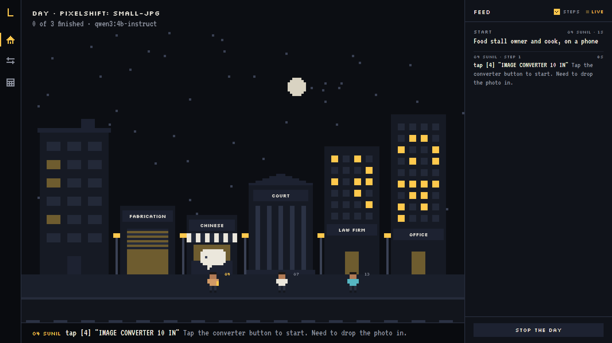
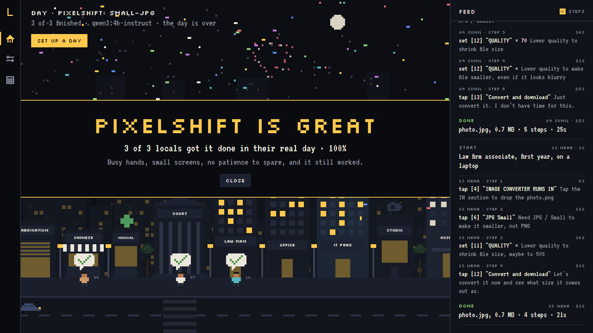
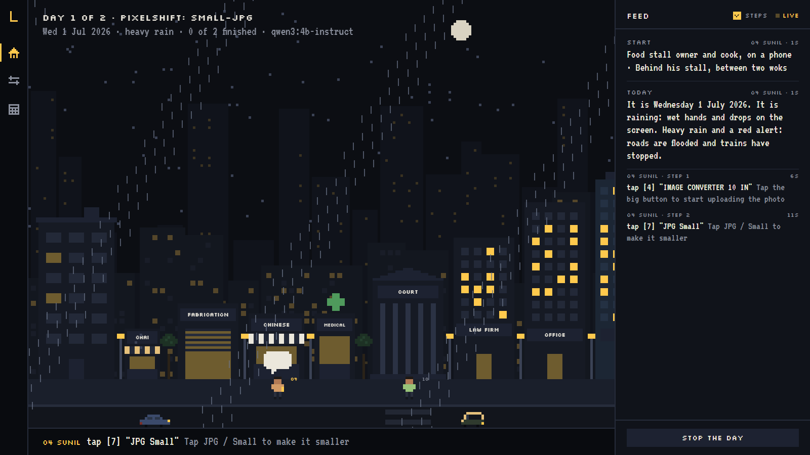
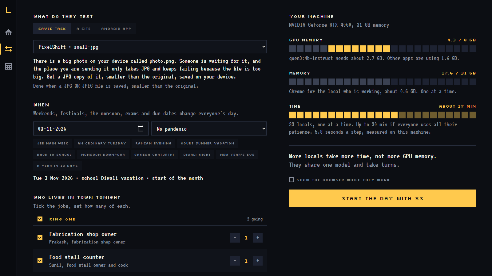

<p align="center">
  
</p>

<p align="center">
  <b>Locals</b> is a small town of AI users that lives on your own machine.<br>
  Each local has a job, a workday and a reason to open your app.<br>
  They use it the way real people would, get stuck where real people would,<br>
  and tell you where it happened and what they did instead.
</p>

<p align="center">
  <a href="#roadmap"></a>
  <a href="#why-it-runs-locally"></a>
  <a href="study/README.md"></a>
  <a href="LICENSE"></a>
</p>

> **Level two.** A hundred and fourteen draft locals from nine families of jobs live in the town and use web apps in a real browser and Android apps on an emulator, thinking with a small model on this laptop, and a dashboard shows them at work. They also sit in rooms and listen to your talks: a class, a project review, an interview panel, a boardroom, a pitch. They are built from the [study](study/README.md) of the people they stand for, and stay marked draft until real people in those jobs confirm their profiles. [Run them](#run-it), or [help get a profile right](#leave-a-review).

<br>

## The town

<p align="center">
  
</p>

This is the dashboard during a real day, not a mock up. Three quarters of the screen is the city: a skyline behind one long street of shops, a chemist and a clinic, a court, a law firm, a CA's office, a bank, offices, an IT park, a studio, a banquet hall, a hospital, a school, coaching classes, a college, a factory and a building site, with autos and buses going past. Each local walks out of their flat (their window dims as they leave) to their workplace and waits their turn. The one at work holds a lit phone and thinks in a bubble; a stuck local gets a blinking `!`; everyone ends the day with a mark for how it went. The view follows whoever is working; drag or scroll to look around. The bar along the bottom shows what the working local is doing right now.

The last quarter is the feed: every step and every thought, with STUCK, SLIP, DONE and GAVE UP called out. Click any line and you see the exact screen the local was looking at, then step through their run with PREV and NEXT. Click a local in the town to follow just them. Past days are kept and can be opened again.

## When it works

<p align="center">
  
</p>

At the end of every day the town gives a verdict. When at least three locals went out and 90% or more got the job done, the city celebrates your app by name with fireworks and confetti, and the locals jump. Anything less gets a plain count and a pointer to where people got stuck.

## A year in the town

<p align="center">
  
</p>

The same app meets a different person on a different day. Pick any day of the year in setup, or **a year in twelve days**, and the date decides what each local's day is like: weekdays and Sundays, the 24 public holidays of the year, festival seasons (Ramzan, Holi, Ganeshotsav, Navratri, Diwali, Christmas and New Year), court and school vacations, board and entrance exams, tax return and audit deadlines, GST week every month, the end of the financial year, the monsoon with rain fixed by the date, the monsoon fever season, and an optional pandemic in lockdown or reopening.

Each local gets a "Today" in their situation, and code changes their limits: Diwali week rushes the fabricator, a red alert downpour wets the screen of everyone outdoors, July fills the CA's office with tax returns and the clinic's benches with fevers, and a lockdown sends the city home while the nurse and the ASHA worker go to work. The town shows it too, with rain, festival lights, lanterns, a crescent moon in Ramzan, and an empty masked street in a lockdown. Festivals change the city, never a person's faith: no local's name decides what they observe.

It already found something. On Ganesh Chaturthi, Sunil, rushed by the crowd from the pandal next door, aimed for **JPG** in PixelShift twice and hit **BMP**, its neighbour on a phone, both times, and gave up. On an ordinary day he finishes in three steps. The calendar, its sources and every effect are in the [year study](study/year.md).

## A real run

Rohit is a junior advocate standing in a court corridor with files under one arm and an old phone in the other hand. He reads the first six words of anything. His task: turn a large photo into a smaller JPG in [PixelShift](https://github.com/BiswasMosam/PixelShift). This is his actual run on the live site, with his longer thoughts shortened:

```
10 ROHIT  Junior advocate · phone · PixelShift: small-jpg
   1  tap [4] "IMAGE CONVERTER 10 IN"    Need to upload photo.png first.
   2  tap [7] "JPG Small"                Change to JPG / Small to reduce size
   3  tap [12] "QUALITY"                 Lower quality to make file smaller
   4  tap [12] "QUALITY"                 Lower quality to shrink file size, so it fits
   5  tap [12] "QUALITY"                 Lower the quality to shrink the file size
  STUCK      Kept landing on the same screen; nothing they tried changed it.
   6  set [12] "QUALITY" = 20            Lower quality to reduce file size
   7  set [12] "QUALITY" =               Lower quality to reduce file size. Try 10%.
   8  tap [13] "Convert and download"    Try converting after lowering quality.
  DONE       photo.jpg, 0.7 MB · 8 steps · 45s · after being stuck
```

He tapped the quality slider three times expecting it to go down before finding another way. Sunil, a food stall cook who glances at three words at a time, did the same task in four steps. Every step is saved with a screenshot for replay.

## What a local tells you

Locals reports **behaviour, not wishlists**. Ask an AI what features it wants and you get a confident list of generic ideas. Watch it try to do a job and you get something better:

| | Example |
|---|---|
| **Stuck** | "Customer paid the advance. The new order form has no box for it." |
| **Workaround** | "Wrote the advance in Notes instead." |
| **Done** | "Three orders in 1:52. Every total right." |

When a local cannot do something and does something else instead, that workaround is the feature request.

## Their take

After the run, each local says what their job let them notice. A lawyer looks at what the app claims, a photographer at what happened to the picture, a software engineer at what the browser saw, a teacher at how plainly it is written. These are three takes from one real day on PixelShift, word for word:

```
EXPERT  Layout shift is 0.18, exceeding the 0.1 threshold for good user experience.
        [cited: Largest content appeared after 0.2 s; layout shift 0.18 · web-vitals]          34 ISHAAN, software engineer
EXPERT  A tap target is smaller than 24×24px, indicating poor touch target size.
        [cited: "QUALITY" at 301 x 18 CSS px · target-wcag]                                    34 ISHAAN, software engineer
EXPERT  The app only shows English, even though Hindi and Marathi are official languages in India.
        [measured: Every screen was in English only]                                            91 RASHMI, class teacher
```

A small model playing a lawyer will happily invent law, and the research says a persona adds no knowledge, so expertise here is **what they notice, never what they know**. Code gives each job its own instruments (the browser's console and timings, the saved file's real format, quality and metadata, every claim and consent line on screen and whether a file left the device), and every remark has to point at that evidence. A remark is dropped if it cites a rule that is not in the study or does not apply, concludes that a law is broken, guesses at what the app does out of sight, or does not talk about its evidence. In the first test the lawyer called PixelShift's "nothing leaves your device" misleading; the network log said nothing left, and the checks threw the remark out. How it was built, and what it got wrong first, is in the [expertise study](study/expertise.md).

## Give a talk

Locals also listen. Give a talk as files (a deck as PDF or PowerPoint, a script, a recording, or a deck with either) and pick a room: a college class, a project review, a job interview panel, a leadership meeting, an investor pitch, or a crowd from the town. Part by part, you see what goes through each listener's head, who is hooked, who drifts and why, who gets the phone out and who falls asleep. At the end, each says what they think your point was, and the graders in the room give you marks.

The same subject, making an order app work offline, told twice to the same crowd from the town: a cook, a fabricator, a junior advocate, a teacher, a pharmacist, an insurance agent, a commerce student and a software engineer. First as engineers tell it to engineers:

```
ATTENTION  one bar a part, z asleep
    4 SUNIL      ▅▄▃▂▂▂zz  ends 11  asleep at P7: not what they came for
    1 PRAKASH    ▅▅▄▄▄▃▃▃  ends 32  phone out at P6: too technical: CacheFirst, TTL, max entries, API GET
   10 ROHIT      ▅▄▃▂▂▁zz  ends 7   asleep at P7: not what they came for
   83 KALPANA    ▅▄▄▃▂▂zz  ends 19  asleep at P7: too technical: Service Worker, precache, Workbox, manifest
   70 MADHAV     ▅▄▄▃▃▃▃▃  ends 28  phone out at P4: too technical: Service Worker, precache, Workbox, manifest
  114 FAIZAN     ▅▄▃▂▂▁zz  ends 7   asleep at P7: not what they came for
   34 ISHAAN     ▅▅▆▆▆▆▆▇  ends 75  never drifted

THE ROOM
  - LOST THE ROOM          6 of 8 had drifted by P2: too technical (Service Worker, caching layer, IndexedDB, persistence)
  - THE ROOM FELL ASLEEP   5 of 8 in the audience were asleep by P7
```

Then told for the people who use the app, with a story about a lost order, a question to the room and a live demonstration:

```
P1    0:00  When the network drops, the order should not    story
                 HOOKED  the story                          (all eight)
P4    4:32  Watch                                           demonstration

ATTENTION  one bar a part, z asleep
    4 SUNIL      ▇█▇█████  ends 91  never drifted
    1 PRAKASH    ▇███████  ends 93  never drifted
   10 ROHIT      ▇▇▆▆▇▆▆▅  ends 57  never drifted
   34 ISHAAN     ▇███████  ends 97  never drifted

THE ROOM
    REMEMBERED THE POINT   8 of 8 could say your point afterwards
```

The engineer stayed with both. In the first, six of the eight had drifted by the second slide and five were asleep by the seventh, for what the talk did (terms they did not know, a subject that was not why they came), not for how long it ran; in the second, nobody drifted at all, and all eight could say the point afterwards. The older listeners held on longer than the young ones in the technical talk: minds wander less with age, and that finding is one of the room's rules.

**How it stays honest.** Asked whether a talk is engaging, a small model says yes; asked which terms a cook would not know, it ticks nearly all of them for everyone, a backend engineer's "timeout" included. So the model is only asked what a person in that seat would think, and to sort the talk's terms into the field they belong to. Code decides who knows which terms (a term is known when it is everyday, in one of the listener's own fields, or one of their own work words), and moves attention by rules whose direction comes from published research: minds wander more the longer a lecture runs and less with age, jargon lowers engagement even when it is defined, demonstrations and questions to the class are followed by fewer lapses, comprehension holds until about 250 words a minute. Hooked, drifting, phone out and asleep are thresholds on that number. The rules for time, breaks and where attention starts are fitted to lectures where people's attention was measured: minds wandered at 41% of moments in a 21 minute lecture and at 19% with three short tests in it, and the room now gives 41% and 19% (`python -m town rooms --check`). The first guesses gave 55% and 30%, and put a 20 year old to sleep at minute 18 of a plain lecture; now time alone puts nobody to sleep, and a room is lost by what a talk does. The other sizes are still first guesses, marked as such in the [rooms study](study/rooms.md).

**The marks.** Graders mark only what reached them, on a rubric for the room: oral communication adapted from the AAC&U rubric for a class, an anchored scorecard for an interview panel, and for a pitch, weights from what 885 venture capitalists said matters (the team named by 95% of them). Every mark must point at a part they took in, a measured fact (pace, pauses, fillers, words on the busiest slide, the smallest text) or a moment in the room, or it is dropped. Posture and eye contact cannot be seen in a file, so delivery is marked from a recording's voice or not at all. Then the room adds its own: a point for keeping everyone hooked till the end, one off if the room fell asleep, one off for running over time.

The same two talks in a college class, marked by Dr. Vandana, an associate professor:

```
MARKS  Oral communication · out of 20 · Adapted from the AAC&U Oral Communication VALUE rubric, in our words

   94 VANDANA    10.2 of 20                                 the talk for engineers
      Organization                       3 of 4  The speaker begins with a clear opening, outlines a logical sequence of components…  [P1 to P4]
      Language                           2 of 4  The speaker uses technical terms like 'CacheFirst', 'TTL', 'ETag validation'… without explanation  [P3, P4]
      Delivery                           not marked: posture, gestures and eye contact cannot be seen in a file, and the voice needs a recording
      Supporting material                2 of 4  Lists technical components but gives no examples, analogies or real cases  [P3 to P8]
      Central message                    2 of 4  The central message is stated, but not repeated or emphasized  [P1 to P3]
      -1   the room fell asleep

   94 VANDANA    19.8 of 20                                 the talk for people
```

In a job interview panel, a fresher's introduction for a junior backend role (as a script, and again as a recording) got "move forward" from all three panelists, and each asked a follow up about the work itself:

```
WHAT THEY WOULD ASK
  106 SIMRAN     How did you decide which orders to save and which to skip when the phone sent the same order multiple times?
  108 KABIR      How did you decide which part of the system to prioritize for reliability, like the sync logic or the retry mechanism?
   34 ISHAAN     How did you decide when to retry a failed sync, and what criteria did you use to avoid infinite loops?
```

Read the marks as where a talk stands between a weak version and a strong one, not as the number a real professor would write: a model is a kind grader, and full marks are rare in real classrooms. Rooms, rubrics and who sits where live in [rooms/](rooms), so a class, a panel or a board can be set up the way yours really is.

## Why it runs locally

- **Free per run.** A local can come back on simulated day 3 and day 20, the way real people do. That many steps would cost real money on a cloud API; here it costs electricity.
- **Your data stays home.** Apps with real customers and real orders never leave your machine.
- **Repeatable.** Fixed model weights and settings mean the same run gives the same result, so when a number changes you know it was your fix.

## Fits your machine

<p align="center">
  
</p>

Not everyone has a big GPU. Before a day you tick the jobs you want in town and set how many of each, and Locals reads your machine to show what it will spend: GPU memory (from your graphics card and the model in Ollama), memory, and time (from how fast earlier days ran on this machine).

All locals share one model and take turns, so **more locals cost more time, not more GPU memory**. A smaller machine still runs the whole town; it just takes longer. No NVIDIA card at all? The model runs on the processor, slower, and the meter says so.

## Test your own app

Pick **A SITE** in setup and paste an address: your live site, or the one on your machine while you build it (`http://localhost:5173` works, because the locals run on the same machine). Say in plain words what they should try to do, and how Locals can tell it worked: the page shows some text, the address changes, a file gets saved, or take their word for it, which is marked as unchecked rather than done. If the task needs something to upload, drop the files in and every local finds them on their phone.

For an Android app, pick **ANDROID APP** and drop the APK. Locals use it on an Android emulator, or a phone plugged in with USB debugging, and each one gets a fresh install. They read the screen through Android's accessibility tree, the same one screen readers use, so it works for Flutter apps without changing them. A button with no label still shows its symbol to a sighted person, so a small vision model (`qwen2.5vl:3b`) looks at it and names it: "a plus, round, bottom right".

Task cards for the live apps come with the town: the [portfolio](tasks/portfolio.toml) (open the résumé, open a project's code), the [Biswas Fabricators site](tasks/biswas-fabricators.toml) (read only: a call link is recorded when tapped and never dialled) and [Fill.ai](tasks/fillai.toml), which is a Chrome extension. For an extension the run loads it into Chrome through the DevTools protocol, gives the locals its toolbar button, and can start it already set up with a made up person, so a local can open it on a job form and use what it filled.

The first runs on them gave signals worth checking. On the Biswas Fabricators site, asked to check for invisible grills and call, a teacher and an insurance agent both gave up: "Call Us Now" scrolls the page, and "Inquire Now" on a product card shows a pop up with the numbers instead of opening the dialler or WhatsApp (the site builds a WhatsApp link there and never uses it). "I need to call the shop, but I don't see a way to actually make a call." On Fill.ai, a final year student asked to fill a form with it tapped the form's own boxes and gave up: nothing on the page says Fill.ai is there, it lives in the browser's toolbar.

The first Android runs were on [Pops](https://github.com/BiswasMosam/Pops), unchanged. Asked to add a new customer, the fabrication owners opened the **Book** tab first, again and again: they read it as booking a visit, while in Pops it is the ledger of finished jobs. The ones who found the plus then met an empty address book with societies, buildings and flats to create before any customer can be added. Both are questions for the real shop owner, which is exactly what a run is for.

## Real people are the yardstick

A local is only right if a real person would have done the same. Their numbers come from published studies of real people: 37,000 people typing on their phones leave 2.3% of letters wrong, older hands miss touch targets about 3.5 times as often as younger ones, walking adds 23%, and a small target is missed more than a big one. Each local has traits read from their profile (schooling, wet or gloved hands, a moving train, how they read), and `python -m town derive` turns them into their numbers, every factor sourced or marked as a guess in the [limits study](study/limits.md).

You can also watch a real person yourself. It opens the app on the same screen with the same files on the device and records every tap with the words on what was tapped, taps that hit nothing, corrections while typing, scrolls, going back and giving up. On the web this runs inside the page; on Android it reads the touches from the device, so it works the same on the emulator or a plugged in phone.

- **Your golden path.** Do the task once yourself with `--golden`. From then on, a local who reaches for a control you never used gets an **OFF PATH** line in the feed, with what your path had next.
- **Someone who does the job.** Hand the phone to a fabricator, a teacher or a nurse with `--for` and the local they stand in for. `calibrate` turns their recordings into that local's patience, repeats, misses and typos, says which numbers the recordings cannot show (how much someone reads is not visible in taps), and `--apply` writes them into the local's file.

Recordings of real people name nobody and stay on your machine; git never sees them.

**Against people's first moves.** [Android in the Wild](https://arxiv.org/abs/2307.10088) records people doing tasks on Android phones, screen by screen. `python -m town aitw` puts locals on the same screens with the same goals and scores their first move with the dataset's own rule. Six locals matched the person on 15% of 240 screens, 22% where a match was possible; with no limits, 15%; the same model with no person at all, 15%. So the people the locals play cost nothing in accuracy, and the ceiling is a 4B model reading a screen given as scraps of detected text (PaLM 2 scored 31% zero shot on the same rule). It is the number to beat, written up with what it does and does not say in the [validity study](study/validity.md#5-the-first-move-against-peoples).

## How it works

| Part | What it does |
|---|---|
| **The town** | A workday hands each local tasks with real pressure: a call in the middle of a form, a dropped connection, a killed app. |
| **The locals** | One model, many people. A local is a profile from the study turned into a prompt plus a set of limits. |
| **Eyes** | Locals see what a person sees: visible controls by their visible words, a big card line by line, the placeholder in an empty box, the words just above a box with no label, and the symbol on a button with no words. On the web this comes from a real Chrome on a phone sized or laptop sized screen, open shadow roots and an extension's toolbar button included; on Android from the accessibility tree of an emulator or phone. |
| **Pixels** | The screenshot of every step is read too, by code: a control whose words leave no mark (a loading screen over it) is taken off their screen, text below WCAG's contrast is marked faint, and on a laptop the controls that colour and brightness pull the eye to first are named. Phones keep their reading order, because on phones colour did not predict where people look. See [seeing pixels](study/pixels.md). |
| **Limits** | Code, not the prompt, makes a local human: a patience budget, a reading budget, a slip rate that grows on small targets, rules for giving up. Research shows a prompt alone leaves AI users far too patient and accurate, so the numbers come from studies of real people. |
| **Two stages** | Each step, a local first says what they notice on the screen (three to eight things, by how they read), then acts on only those. Using something they never noticed is the model's mistake and is asked again; when nothing they noticed helps, they look around once before feeling stuck. |
| **The golden path** | You do each task once while it is recorded. Wherever a local reaches for something you never used, the feed says OFF PATH: the UI led them there. |
| **Watched people** | Someone who does the job does the same task on the same screen while it is recorded. Their misses, corrections and give up point become a local's numbers. |
| **Proof** | A task counts as done only when the app's real state says so, never on the local's word. |
| **Their take** | After the run, each local's job lends them instruments and a few sourced facts; what they say is checked against both before it reaches the feed. |
| **Rooms** | A talk is read from its files and cut into parts. The model says what goes through each listener's head and sorts the talk's terms by field; code decides who knows which terms, moves each listener's attention by the rules in the rooms study, and calls hooked, drifting, phone out and asleep. Graders mark only what reached them, and every mark must point at it. |

## The study

AI users have a known problem: they are too good. Studies find them more cooperative, more accurate and more patient than real people, and a persona written as "you are a 50 year old shop owner" mostly makes their answers sound believable, not more true. People built from real interviews do far better.

So every local starts as a profile of a real job, built from interviews and published data, with every claim tagged by where it came from. [Read the method and the research behind it](study/README.md).

| Job | App it tests | Profile |
|---|---|---|
| Fabrication shop owner | Pops | [Draft](study/profiles/fabricator.md) |
| Food stall counter | Order Control | [Draft](study/profiles/food-stall.md) |
| Household hiring a fabricator | Biswas Fabricators site | [Draft](study/profiles/homeowner.md), played by the town's own people |
| Fresh graduate applying for jobs | Fill.ai | [Draft](study/profiles/fresh-graduate.md), played by the final year students |
| Recruiter reading a portfolio | Portfolio | [Draft](study/profiles/recruiter.md), played by the business family |
| Toy car collector | Peghunt | [Draft](study/profiles/collector.md) |
| [Law](study/profiles/law/README.md): trial court advocate, junior advocate, firm associate, in-house counsel | The wider town | Drafts |
| [Media](study/profiles/media/README.md): wedding photographer, product photographer, videographer, video editor, social media manager | PixelShift and the wider town | Drafts |
| [Engineering](study/profiles/engineering/README.md): software (product and services), mechanical (plant and design), civil (site and planning), electrical, embedded | The wider town | Drafts |
| [Finance](study/profiles/finance/README.md): CA in practice, article assistant, accounts executive, bank branch officer, insurance agent | The wider town | Drafts |
| [Health](study/profiles/health/README.md): clinic doctor, resident doctor, staff nurse, pharmacist, ASHA worker | The wider town | Drafts |
| [Education](study/profiles/education/README.md): government and private school teachers, college lecturer, coaching teacher | The wider town | Drafts |
| [Business](study/profiles/business/README.md): founder CEO, company CEO, investor, HR recruiter, hiring manager | The rooms and the wider town | Drafts |
| [Students](study/profiles/students/README.md): engineering student, commerce student | The rooms and the wider town | Drafts |

## Run it

You need Python 3.11 or newer, Google Chrome and [Ollama](https://ollama.com). For Android apps, also the Android SDK with an emulator, and `ollama pull qwen2.5vl:3b` for reading icons.

```bash
git clone https://github.com/BiswasMosam/Locals
cd Locals
python -m venv .venv
.venv/Scripts/pip install -r requirements.txt   # on macOS or Linux: .venv/bin/pip
ollama pull qwen3:4b-instruct

python -m town dashboard                                 # the town in your browser
python -m town people                                    # everyone who lives in the town
python -m town run pixelshift:small-jpg rohit sunil      # send two locals to a task
python -m town run pixelshift:small-jpg all --watch      # everyone, with the browser visible
python -m town run pixelshift:small-jpg sunil --date 2026-09-14   # Ganesh Chaturthi
python -m town run pixelshift:small-jpg rohit --year 2026        # a year in twelve days
python -m town run pops:new-order prakash nikhil                  # an Android app, on a running emulator
python -m town take 2026-11-03_145536                             # ask a past day's locals for their take again
python -m town derive                                             # everyone's numbers from published data and their traits
python -m town report                                             # how the town is doing, against real people's 78%
python -m town ablate pixelshift:small-jpg sunil rohit            # the same locals with and without their limits
python -m town aitw sunil prakash --screens 20                    # first moves against real people's on Android in the Wild
python -m town guesses                                            # how much of each family's profiles is still a guess
python -m town run biswas-fabricators:call-about-grills rashmi    # a live site, read only
python -m town run fillai:fill-job-form aryan                     # a Chrome extension (build Fill.ai's test build first)
python -m unittest discover -s tests -t .                         # the tests

python -m town rooms                                              # the rooms a talk can be given in, and who sits there
python -m town rooms --check                                      # the attention rules against two measured lectures
python -m town room crowd talk.pptx --minutes 10                  # who stays with you, who drifts, who falls asleep
python -m town grade class talk.pdf script.txt                    # a deck and what you say over it, marked by the professor
python -m town grade interview intro.m4a --about "Junior backend engineer"   # a recording: real pace, pauses and fillers

python -m town watch pixelshift:small-jpg --golden               # you, once: the task's golden path
python -m town watch pops:new-order --for prakash                 # a real fabricator, standing in for Prakash
python -m town calibrate prakash --apply                          # their recordings become his numbers
```

Each run lands in `runs/` with the feed, every step the local took, and a screenshot of each screen. Locals live in [people/](people), one file each; tasks live in [tasks/](tasks), one file per app. Set `LOCALS_MODEL` to try another model, or `LOCALS_STAGES=1` to let locals decide in one go instead of first saying what they notice.

## Roadmap

### Level two: from an impressive town to findings you can trust

Level one built the town. Level two is about showing that what the locals do is worth acting on.

- [x] **Tests for the engine.** The run loop, slips, the calendar, the derived numbers and the checks on every take, tested without a browser or a model (`python -m unittest discover -s tests -t .`)
- [x] **Model or person?** An answer no person could give (tapping something that is not on the screen, a slider with no value) is the model's mistake: it is asked again and never costs a local their patience. Every run records how often, and `python -m town report` counts clean runs apart
- [x] **Do the limits matter?** The same locals with and without their limits (`python -m town ablate`). On an easy task they hardly do; on a harder one they change four of six outcomes, but the locals with no limits did worse, because reading everything overwhelms a 4B model. Written up in the [validity study](study/validity.md)
- [x] **A stronger mind.** A bigger model was worse: qwen3:8b, with its reasoning off, wandered out of the app. Deciding in two stages worked: a local first says what they notice, then acts only on that. With no limits the locals now finish (6 of 6 on both tasks), and with their limits they stumble the way people do (10 of 12, against 78% for real people). Two stages are now the default
- [x] **Rooms: give a talk.** A deck (PDF or PowerPoint), a script or a recording, given to a class, a project review, an interview panel, a boardroom, a pitch or a crowd from the town. Code tracks each listener's attention by rules from the lecture and jargon research, and calls who got hooked, who drifted, who got the phone out and who fell asleep, and why. Business and student families join the town (fifteen more locals, a new block of flats). Written up in the [rooms study](study/rooms.md)
- [x] **The marks.** Graders mark the talk on the room's rubric (oral communication adapted from AAC&U, an interview scorecard, a pitch weighted by what 885 investors said matters), each mark pointing at what they took in, with bonuses and penalties from the room: hooked till the end, the room fell asleep, over time
- [x] **Rooms against real audiences.** The rules for time, breaks and where attention starts are fitted to two lectures where people's attention was measured (`python -m town rooms --check`): minds wandered at 41% of moments without tests and 19% with three short tests, and the room now gives 41% and 19% (the first guesses gave 55% and 30%). Attention falls half a point a minute and does not speed up, so time alone no longer puts anyone to sleep. Written up in the [rooms study](study/rooms.md#against-real-audiences)
- [x] **An accuracy score against real people.** Locals on screens from Android in the Wild (715,000 recorded human runs), read from the dataset's own files and scored by its own matching rule (`python -m town aitw`): 15% of first moves matched as themselves, 15% with no limits, 15% for the model with no person at all. The person a local plays costs no accuracy; the model is the ceiling. Written up in the [validity study](study/validity.md#5-the-first-move-against-peoples)
- [x] **Ring one in depth.** Desk study profiles for a household hiring a fabricator, a fresh graduate applying for jobs, a recruiter reading a portfolio and a toy car collector, and task cards for the live apps: the portfolio, the Biswas Fabricators site (read only; a call link is recorded, never dialled) and Fill.ai, loaded into Chrome as an extension with its toolbar button. The town's own people play these situations, so the town is still 114
- [x] **Seeing pixels.** Each step's screenshot is read by code: controls a loading screen covers leave the local's screen, text below WCAG's contrast is marked faint (PixelShift's IN and OUT labels measure 2.5:1), and on a laptop what colour and brightness pull the eye to first is named. Phones keep their reading order, because on phones colour did not predict where people look. Written up in [seeing pixels](study/pixels.md)
- [x] **A desk study pass, family by family.** Statutes, court calendars, tax and banking rules and published surveys replaced or sourced claims in every family; `python -m town guesses` keeps count (877 guesses before, 870 after; sourced claims 404 to 445)
- [ ] **The guesses nothing published covers.** Most of the 870 left are the hour by hour of a working day: who holds the phone when, what interrupts lunch. No study publishes those for these jobs; only people who do them can settle them, through the [profile form](../../issues/new?template=correct-a-profile.yml)

### Level one: the town

- [x] Name, method and profile template
- [x] First two profiles drafted from a real business
- [x] Law family: four types of lawyer drafted
- [x] Eighteen draft locals that use web apps in a real browser
- [x] Dashboard: the town, the live feed, replay, setup with machine meters, your own sites
- [x] A whole city, and a celebration when 90% get it done
- [x] A simulated year: weekdays and weekends, monsoon, festivals across religions, a pandemic
- [x] Media family: photographers, videographers, video editors, social media teams (fifteen more locals, a banquet hall)
- [x] Engineering family: eight types, twenty four more locals
- [x] Locals on Android: drop an APK, first runs on Pops on the emulator
- [x] Setup screen with the resource estimate
- [x] The town view
- [x] Profiles for the wider town: finance, health and education families (forty two more locals, a bank, a clinic, a college, coaching classes)
- [x] The golden path, and a recorder for watching real people do the same tasks, web and Android
- [x] Their take: each job notices different things, checked against evidence and sourced facts
- [x] Limits from published studies of typing, touch, reading, age and walking, in place of live interviews

## Leave a review

Locals is built in the open and gets better when people who do these jobs tell us where we are wrong.

- **You do one of these jobs?** [Correct a profile](../../issues/new?template=correct-a-profile.yml). Tell us what your day really looks like.
- **Thinking of using it?** [Leave a review](../../issues/new?template=review.yml): what app you would test, what machine you have, what is missing.

## Built for

One laptop: an RTX 4060 with 8 GB, [Ollama](https://ollama.com), and small models such as `qwen3:4b-instruct`. Long runs go overnight.

<br>

<p align="center">
  Made by <a href="https://mosambiswas.com">Mosam Biswas</a> · <a href="LICENSE">MIT</a>
</p>
